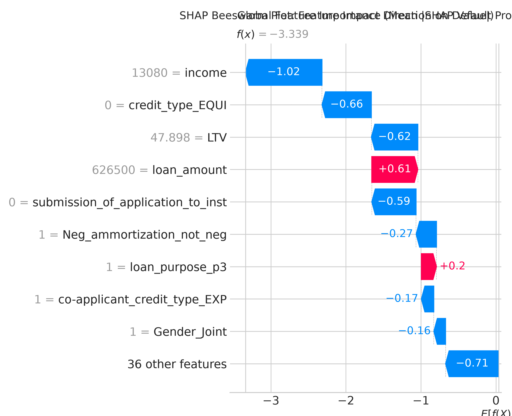
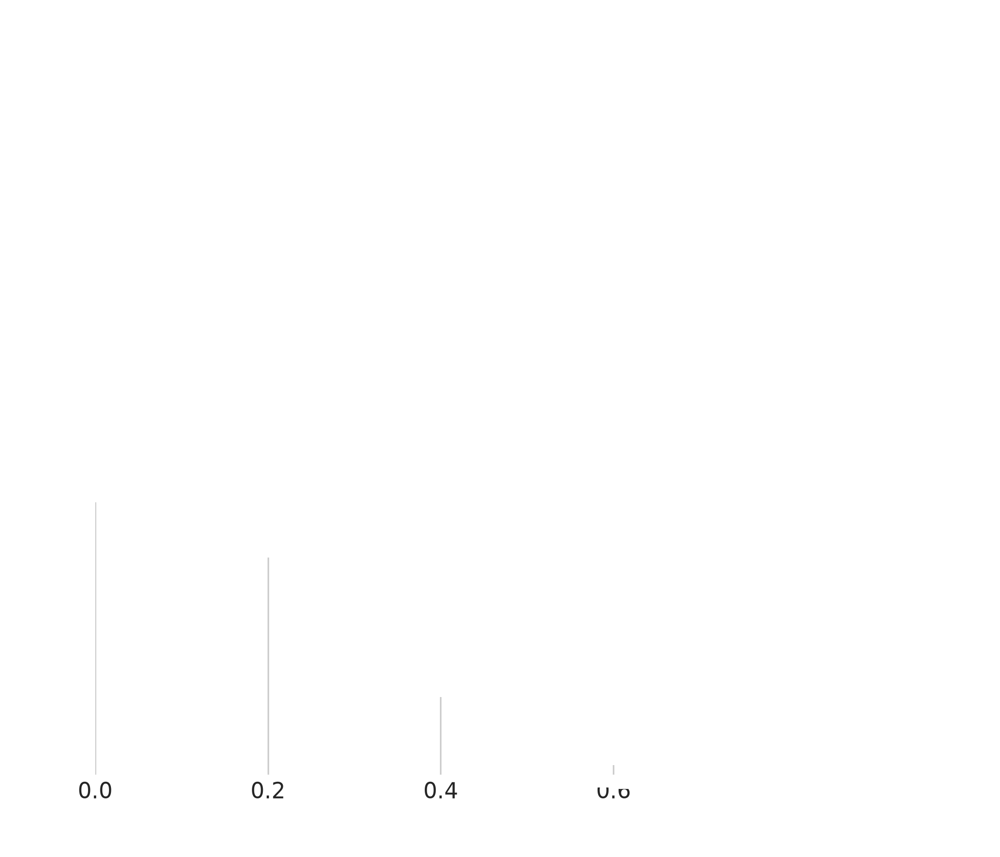
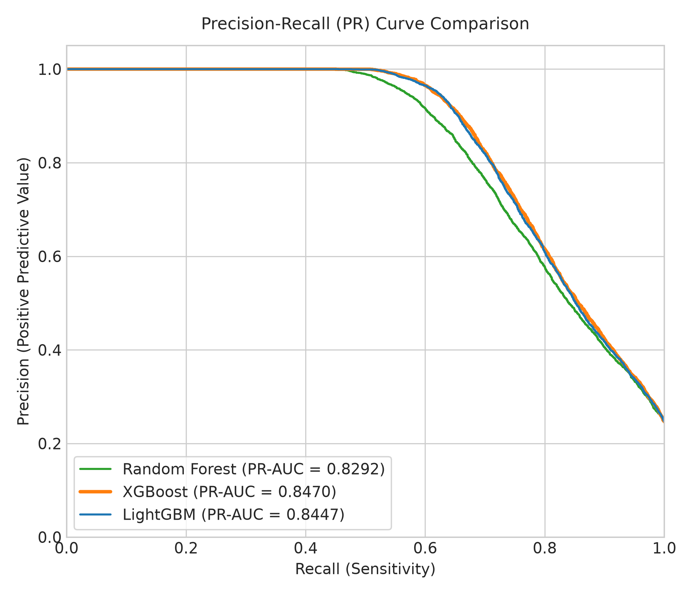

<div align="center">
  <br />
  
  <br />
</div>
<div align="center">

# 🏦 CrediSHAP
### Explainable Machine Learning for Loan Default Prediction

[](https://www.python.org/)
[](https://xgboost.readthedocs.io/)
[](https://shap.readthedocs.io/)
[](https://streamlit.io/)
[](LICENSE)

*A SHAP-Integrated, Class-Balance-Aware ML Framework for Real-Time, Interpretable Credit Risk Assessment*

</div>

---

## 📌 Overview

**CrediSHAP** is a research-grade, transparent credit risk classification framework that predicts loan default probability while ensuring:

- ✅ **Zero data leakage** — all preprocessing fitted strictly inside training folds
- ✅ **Class imbalance handling** — SMOTE applied only within training partitions
- ✅ **Threshold optimization** — decision boundary tuned via OOF F1-maximization
- ✅ **Full explainability** — global & local SHAP attributions via TreeExplainer

> **⚠️ Advisory:** CrediSHAP is a decision-support tool for loan officers. It is **NOT** an automated lending decision or credit approval engine.

---

## 🏗️ Architecture & Model Selection

Rather than a black-box ensemble, CrediSHAP uses a disciplined **model-selection protocol**:

1. Evaluates **Random Forest**, **XGBoost**, and **LightGBM** under identical leakage-safe 3-fold Stratified CV
2. Selects a single **Champion Model** by highest CV F1-Score on the un-resampled validation distribution
3. Optimizes the classification threshold strictly on OOF predictions — test set never touched
4. Deploys the champion with **TreeExplainer SHAP** attribution

---

## 📂 Repository Structure

```
CrediSHAP/
├── data/
│   └── README.md               # Instructions to download dataset from Kaggle
├── notebooks/
│   └── Loan.ipynb              # Baseline exploration notebook
├── src/
│   ├── preprocessing.py        # Leakage-safe imblearn pipeline (imputation, OHE, SMOTE)
│   ├── tune.py                 # Bayesian optimization via Optuna (per-fold pipeline fitting)
│   ├── train.py                # 3-Fold CV model comparison, champion selection, OOF threshold tuning
│   ├── evaluate.py             # Isolated test evaluation, metrics & plots
│   ├── explain.py              # TreeExplainer SHAP summary, beeswarm, waterfall plots
│   └── predict.py              # Inference pipeline with advisory notice & fairness warnings
├── models/
│   ├── model.pkl               # Serialized champion model (XGBoost)
│   ├── preprocessor.pkl        # Serialized fitted CrediSHAPPreprocessor
│   ├── threshold.json          # Optimal locked classification threshold (0.35)
│   └── metadata.json           # Machine-readable experimental metadata
├── outputs/
│   ├── confusion_matrix.png
│   ├── roc_curve.png
│   ├── precision_recall_curve.png
│   ├── model_comparison.png
│   ├── shap_summary.png
│   ├── shap_beeswarm.png
│   └── local_explanation.png
├── app/
│   └── streamlit_app.py        # Interactive Streamlit decision-support dashboard
├── .streamlit/
│   └── config.toml             # Streamlit theme config
├── requirements.txt
├── main.py                     # Master end-to-end execution script
├── test_inference.py           # Saved-model inference test
└── README.md
```

---

## 📊 Results

### 3-Fold Cross-Validation (Leakage-Safe Validation Distribution)

| Model | Accuracy | Precision | Recall | F1-Score | ROC-AUC | PR-AUC |
|:---|:---:|:---:|:---:|:---:|:---:|:---:|
| Random Forest | 87.95% | 94.38% | 54.43% | 0.6904 | 0.8827 | 0.8182 |
| LightGBM | 89.32% | 92.72% | 61.18% | 0.7372 | 0.8919 | 0.8363 |
| **XGBoost ✅ Champion** | **89.36%** | **92.12%** | **62.14%** | **0.7421** | **0.8936** | **0.8382** |

### Final Test Set Performance (29,734 Untouched Samples)

| Model | Threshold | Accuracy | Precision | Recall | F1-Score | ROC-AUC |
|:---|:---:|:---:|:---:|:---:|:---:|:---:|
| Random Forest | 0.50 | 88.58% | 95.24% | 56.48% | 0.7091 | 0.8878 |
| LightGBM | 0.50 | 89.89% | 93.83% | 63.13% | 0.7548 | 0.8958 |
| XGBoost (default) | 0.50 | 89.86% | 93.09% | 63.56% | 0.7554 | 0.8979 |
| **XGBoost — CrediSHAP** | **0.35** | **89.34%** | **85.38%** | **68.46%** | **0.7599** | **0.8979** |

**Confusion Matrix at threshold 0.35:**

```
True Negatives  (TN): 21,548   |   False Positives (FP):  858
False Negatives (FN):  2,311   |   True Positives  (TP): 5,017
```
> Captures **68.46%** of all defaulters with **85.38%** precision.

---

## 📈 SHAP Visualizations

| Global Feature Importance | Beeswarm Plot |
|:---:|:---:|
|  |  |

| ROC Curve | Precision-Recall Curve |
|:---:|:---:|
|  |  |

---

## 🚀 Quick Start

### 1. Clone the Repository
```bash
git clone https://github.com/jaydeep-codes/CrediSHAP-Loan-Default-Prediction.git
cd CrediSHAP-Loan-Default-Prediction
```

### 2. Install Dependencies
```bash
pip install -r requirements.txt
```

### 3. Download the Dataset
Get `dataset.csv` from [Kaggle](https://www.kaggle.com/datasets/nikhil1e9/loan-default) and place it in `data/`.

### 4. Run Full Pipeline
```bash
python main.py
```

### 5. Test Saved-Model Inference
```bash
python test_inference.py
```

### 6. Launch Interactive Dashboard
```bash
streamlit run app/streamlit_app.py
```

---

## ⚖️ Fairness & Regulatory Limitations

- **`Region_south`** is a top SHAP feature — geographic variables can proxy for race/ethnicity (potential **disparate impact / redlining** under the Fair Housing Act)
- **`Gender`** is present in the dataset — using it in production underwriting likely violates the **Equal Credit Opportunity Act (ECOA)**
- **Production Recommendation:** Remove `Gender` and `Region` before deployment; audit for Demographic Parity and Disparate Impact across all protected groups

---

## 🛠️ Tech Stack

| Category | Library |
|---|---|
| ML Models | XGBoost, LightGBM, scikit-learn |
| Imbalance Handling | imbalanced-learn (SMOTE) |
| Hyperparameter Tuning | Optuna |
| Explainability | SHAP |
| Visualization | Matplotlib, Seaborn |
| Dashboard | Streamlit |
| Serialization | joblib |

---

## 📄 License

This project is licensed under the **MIT License** — see [LICENSE](LICENSE) for details.

---

<div align="center">
Made with ❤️ by <a href="https://github.com/jaydeep-codes">jaydeep-codes</a>
</div>
